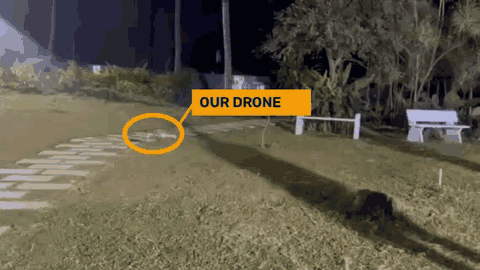
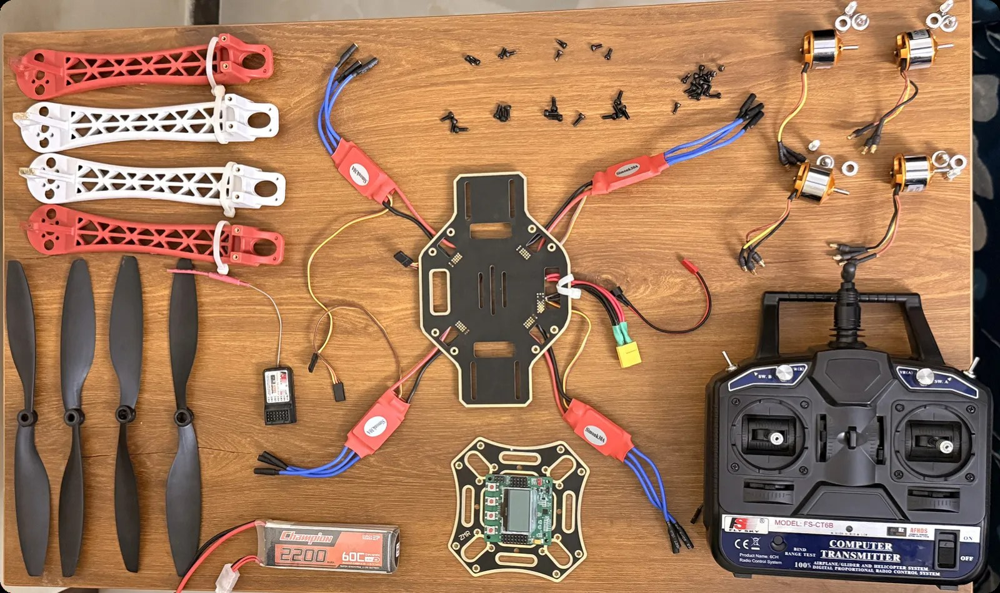
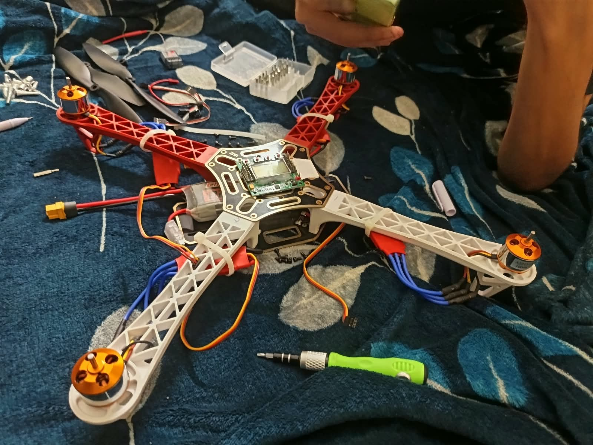
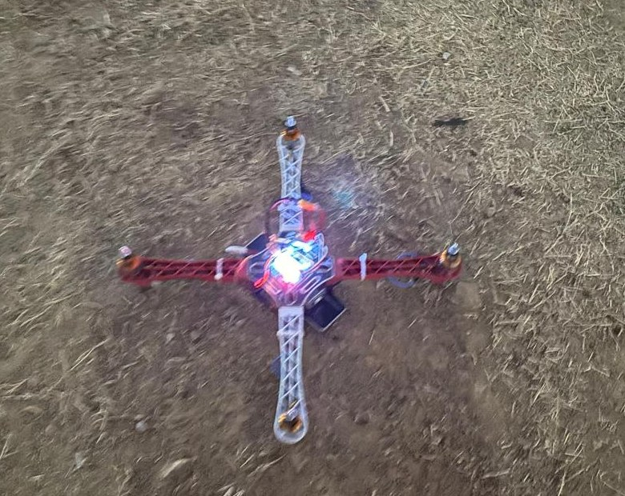
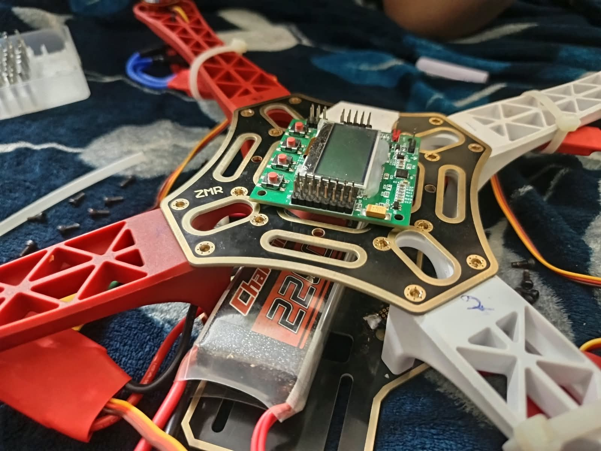
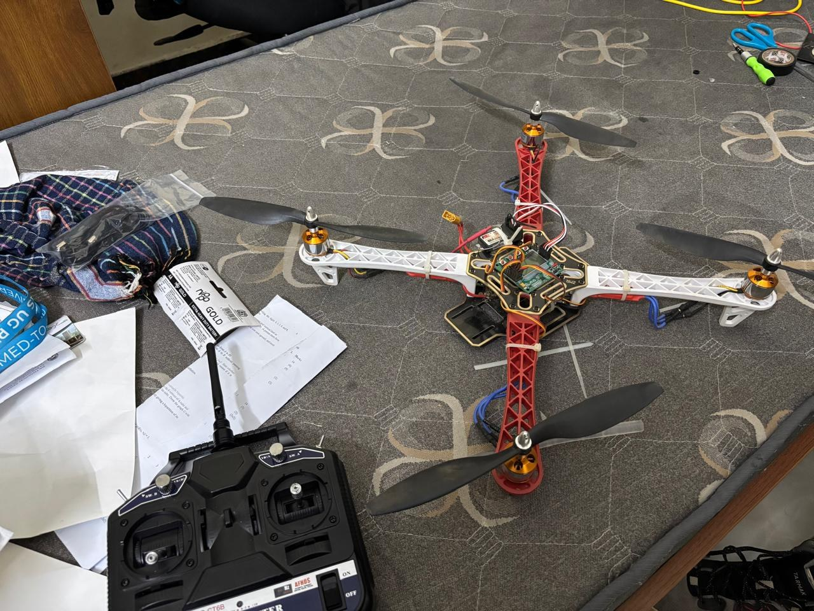
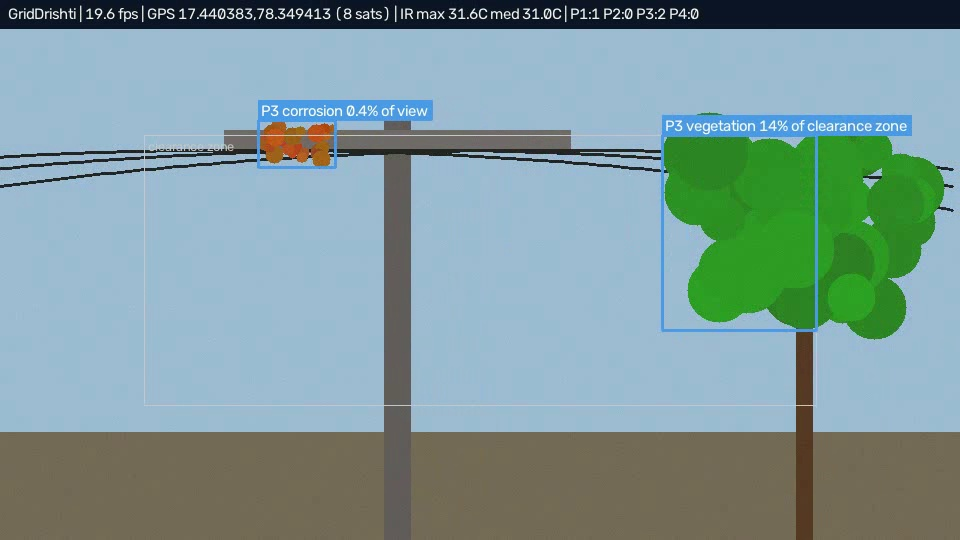

# GridDrishti 🚁⚡
**Low-cost AI drone inspection for power lines, feeders and substations**

By **The Burnouts** (Newton School of Technology, Bengaluru). Submission for **TISC 2026 (Telangana Innovation Startup Challenge), Challenge 09: Drone Based Monitoring** (Energy Department).

<p align="center">
  
  <br><em>First flight test: our drone lifting off (circled)</em>
</p>

---

## Why

Telangana's feeders, lines and substations stretch across urban, industrial and rural land, and most of them are still inspected **on foot**. That is slow and subjective. Defects like **corrosion, conductor sag, trees growing into lines, cracked insulators and hot joints** are often found only *after* they cause an outage. Crews also have no clear list of **which fault to fix first**.

## What

GridDrishti is a drone we built ourselves, plus a laptop "ground station" that:

1. **Flies** along a feeder with a camera, a thermal sensor and GPS
2. **Streams** live video and data to a laptop over Wi-Fi
3. **Detects** corrosion, vegetation in the clearance zone and thermal hotspots (YOLO for broken insulators is the next step)
4. **Ranks** every defect **P1 → P4** by severity and pins it on a map with a photo

| Priority | Action | Example |
|---|---|---|
| 🔴 **P1** | Dispatch crew now | Hotspot ΔT > 15 °C, broken insulator |
| 🟠 **P2** | Repair within days | ΔT 4–15 °C, heavy corrosion |
| 🔵 **P3** | Next maintenance | Rust, vegetation in clearance zone |
| ⚪ **P4** | Monitor | ΔT 1–3 °C, surface rust |

Outputs: live annotated video, `defects.csv` (ranked work list), `defect_map.html` (clickable map with photos).

```
 Drone                                   Laptop (ground station)
 ESP32-CAM ──── Wi-Fi video ──────────▶  ground_station.py
 ESP32 + GPS + MLX90640 ── UDP ───────▶  detect → rank P1–P4 → GPS tag
 KK2.1.5 flight controller (flies now)   → defects.csv + defect_map.html
 ESP32 + MPU6050 own FC (bench test)
```

## The build

| Parts | Assembled | Ready to fly |
|---|---|---|
|  |  |  |

| Flight controller | With props and transmitter | Ground station test run |
|---|---|---|
|  |  |  |

## Bill of materials (BOM)

> Prices are approximate Indian retail prices. Update them with your actual receipts.

| # | Part | Qty | Approx. cost (₹) | Status |
|---|---|---|---|---|
| 1 | F450 quad frame (450 mm, with PDB) | 1 | 1,200 | ✅ Have |
| 2 | A2212 1000 KV brushless motor | 4 | 1,600 | ✅ Have |
| 3 | SimonK 30 A ESC | 4 | 2,000 | ✅ Have |
| 4 | 1045 propellers (CW + CCW) | 2 pairs | 300 | ✅ Have |
| 5 | KK2.1.5 flight controller | 1 | 1,800 | ✅ Have |
| 6 | FlySky FS-CT6B transmitter + receiver | 1 | 3,500 | ✅ Have |
| 7 | 3S 2200 mAh 60C LiPo (Champion) | 1 | 2,000 | ✅ Have |
| 8 | XT60, bullet connectors, zip ties, screws | – | 500 | ✅ Have |
| 9 | ESP32-CAM (OV2640) | 1 | 600 | Inspection payload |
| 10 | ESP32 dev board (telemetry) | 1 | 450 | Inspection payload |
| 11 | NEO-6M GPS | 1 | 500 | Inspection payload |
| 12 | MLX90640 thermal camera (32×24) | 1 | 4,000–8,000 | Inspection payload |
| 13 | 5 V 3 A UBEC | 1 | 300 | Inspection payload |
| 14 | ESP32 + MPU6050 (own flight controller) | 1 | 600 | R&D |
| | **Flying drone (1–8)** | | **≈ 12,900** | |
| | **With inspection payload (1–14)** | | **≈ 19,000–23,000** | |

**V2 upgrade (AI on board):** Raspberry Pi 5 8 GB (about ₹8,500 + GST), Raspberry Pi AI HAT+ 26 TOPS (about $110), Pi Camera Module 3, 5 V 5 A UBEC.

## Repository layout

```
ground_station/            Python app: detection, severity ranking, map, CSV
esp32_cam_stream/          ESP32-CAM sketch: live MJPEG video over Wi-Fi
esp32_telemetry/           ESP32 sketch: GPS + MLX90640 thermal → UDP
esp32_flight_controller/   Our own flight controller (ESP32 + MPU6050), bench prototype
media/                     5-second flight GIF and clip (drone circled)
video/                     Full flight test video
images/                    Build and team photos
docs/                      Setup guide, TISC application text, pitch deck
```

Each code folder has its own `README.md` with wiring and run steps.

## Quick start (no hardware needed)

```bash
cd ground_station
python3 -m venv venv && source venv/bin/activate
pip install -r requirements.txt
python make_test_video.py test.mp4      # synthetic pole + rust + tree
python fake_telemetry.py &              # fake GPS + a hot joint
python ground_station.py --source test.mp4 --record
```

With the real drone: `python ground_station.py --source http://<esp32-cam-ip>:81/stream --record`.
Full wiring, flashing and bench-test steps are in **[docs/SETUP.md](docs/SETUP.md)**.

## Roadmap

- [x] Drone built and flying (KK2.1.5)
- [x] Ground station: detection, P1–P4 ranking, GPS map, CSV
- [ ] ESP32 + MPU6050 flight controller: bench → tethered → free flight
- [ ] MLX90640 + GPS on the drone, flight over a mock pole
- [ ] YOLO trained on InsPLAD (10,607 real UAV images of power-line parts) + local images
- [ ] **V2: Raspberry Pi 5 + AI HAT+**, so AI runs on board and only alerts are sent over 4G
- [ ] ArduPilot waypoint missions along a feeder
- [ ] Pilot on one 11 kV feeder and substation with a DISCOM

## Safety

Test only over open ground or on a mock pole. **Never fly near live lines** without the utility's permission and a safe stand-off distance. The drone is under 2 kg (micro category under India's Drone Rules 2021). Commercial use needs Digital Sky registration and a certified remote pilot. Run the custom flight controller **with props off** until every bench check in `docs/SETUP.md` passes.

## Team: The Burnouts

Newton School of Technology, Bengaluru (S-VYASA) · Contact: **ayushpro1428@gmail.com**

| | Member | Role | Highlights | Links |
|---|---|---|---|---|
|  | **Ayush Kumar** | Hardware & flight control | B.Tech CSE. Built ESP32 (double-loop PID, sensor fusion) and STM32F405 flight controllers from scratch. 26 hardware projects, 400+ hours, Hack Club-approved PCBs. | [GitHub](https://github.com/AYUSH-pro-grammer) · [LinkedIn](https://www.linkedin.com/in/ayushpro1428/) · [Portfolio](https://ayushpro1428.tech) |
|  | **Divyanshu Prakash** | Autonomy & software | ISRO IRoC-U semifinalist with an autonomous drone built for GPS-denied environments. Kubernetes contributor. | [GitHub](https://github.com/divyanshuprakas-h) · [LinkedIn](https://www.linkedin.com/in/divyanshuprakas-h/) |

📄 Pitch deck: [`docs/GridDrishti_Pitch_Deck.pdf`](docs/GridDrishti_Pitch_Deck.pdf) · 📝 [TISC application text](docs/TISC_application.md)

## License

MIT. See [LICENSE](LICENSE).
